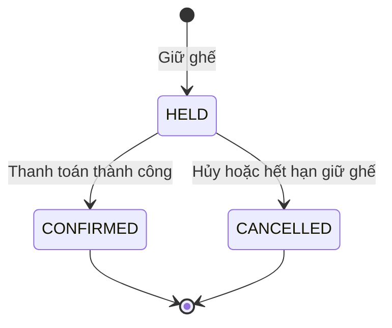

# OBTP — Online Bus Ticket Platform

Nền tảng trung gian kết nối các nhà xe liên tỉnh để bán vé. Hành khách tìm chuyến, giữ ghế, thanh toán và nhận vé điện tử (QR code) qua email; nhà xe quản lý vận hành và doanh thu; quản trị viên quản lý hệ thống và ăn chia hoa hồng.

Dự án nhóm 3 người, tổ chức theo kiến trúc **monorepo** (Turborepo + pnpm).# OBTP — Online Bus Ticket Platform

Nền tảng trung gian kết nối các nhà xe liên tỉnh để bán vé. Hành khách tìm chuyến, giữ ghế, thanh toán và nhận vé điện tử (QR code) qua email; nhà xe quản lý vận hành và doanh thu; quản trị viên quản lý hệ thống và ăn chia hoa hồng.

Dự án nhóm 3 người, tổ chức theo kiến trúc **monorepo** (Turborepo + pnpm).

## Mục lục

- [Kiến trúc](#kiến-trúc)
- [Tính năng](#tính-năng)
- [Quy trình đặt vé](#quy-trình-đặt-vé)
- [Công nghệ](#công-nghệ)
- [Bắt đầu](#bắt-đầu)
- [Biến môi trường](#biến-môi-trường)
- [Scripts](#scripts)
- [Phân công](#phân-công)

## Kiến trúc

Hệ thống gồm 1 API dùng chung và 4 ứng dụng client, cùng các package dùng chung giữa chúng.

| Ứng dụng | Package | Đối tượng sử dụng |
| --- | --- | --- |
| API | `api` | Backend REST API (NestJS) |
| Web | `web` | Hành khách |
| Portal | `portal` | Nhà xe (quản trị nhà xe) |
| Admin | `admin` | Quản trị viên hệ thống |
| Mobile | `vexe-mobile` | Tài xế và hành khách |

| Package dùng chung | Mô tả |
| --- | --- |
| `@obtp/business-logic` | Logic nghiệp vụ dùng chung (tính tiền, thời hạn giữ ghế, sinh mã vé, hằng số nghiệp vụ) |
| `@obtp/shared-types` | Kiểu dữ liệu và enum dùng chung (trạng thái booking, ghế, chuyến, vai trò...) |
| `@obtp/validation` | Schema validation dùng chung (Zod) |
| `@obtp/api-client` | API client dùng chung cho các ứng dụng frontend |

## Tính năng

### Hành khách (Web và Mobile)
- Tìm chuyến, chọn ghế và giữ ghế tạm thời.
- Thanh toán qua **PayOS** hoặc **VietQR**.
- Nhận vé qua email dưới dạng **mã QR**.
- Tra cứu vé bằng mã vé và số điện thoại liên hệ.
- Xem lịch sử đặt vé, hủy vé khi chưa thanh toán.

### Tài xế (Mobile)
- Quét mã QR trên vé để xác nhận hành khách lên xe.

### Nhà xe (Portal)
- Quản lý xe của nhà xe.
- Quản lý tuyến đường của nhà xe.
- Quản lý tài xế.
- Quản lý vé của từng chuyến.
- Theo dõi doanh thu và hoa hồng.

### Quản trị viên (Admin)
- Quản lý người dùng.
- Tiếp nhận đăng ký, tạo tài khoản và quản lý nhà xe.
- Ăn chia hoa hồng doanh thu hằng tháng.

Hoa hồng được tính **theo từng vé** (mặc định 15%, cấu hình qua biến `COMMISSION_RATE`).

## Quy trình đặt vé

1. Hành khách chọn chuyến và ghế. API tạo booking ở trạng thái `HELD` và giữ ghế trong `SEAT_HOLD_DURATION_MINUTES` (mặc định 15 phút).
2. Hành khách thanh toán qua PayOS hoặc VietQR.
3. Thanh toán thành công: booking chuyển sang `CONFIRMED`, ghế chuyển sang `BOOKED`, hệ thống sinh mã vé và gửi vé QR qua email.
4. Nếu không thanh toán kịp, tiến trình dọn dẹp định kỳ tự động hủy booking và nhả ghế.
5. Khi lên xe, tài xế quét QR trên Mobile để xác nhận vé.



Trạng thái ghế: `AVAILABLE` → `HELD` → `BOOKED` (trở về `AVAILABLE` khi booking bị hủy hoặc hết hạn).

## Công nghệ

| Thành phần | Công nghệ |
| --- | --- |
| Monorepo | Turborepo, pnpm workspaces, TypeScript |
| Backend | NestJS 11, Express 5, MongoDB + Mongoose 9, Passport + JWT, Zod, class-validator |
| Thanh toán | PayOS, VietQR |
| Email | Nodemailer (SMTP) |
| Web (hành khách) | React 19, Vite, MUI, Redux Toolkit, TanStack Query, React Router 7 |
| Portal (nhà xe) | React 19, Vite, MUI, TanStack Query, React Hook Form, React Router 7 |
| Admin | React 19, Vite, TanStack Query, React Hook Form, React Router 7 |
| Mobile | Expo 54, React Native 0.81, React Navigation, Redux Toolkit, react-native-maps, expo-camera |

## Bắt đầu

### Yêu cầu

- Node.js 20 trở lên
- pnpm 9
- MongoDB (chạy local)

### Cài đặt

```bash
git clone https://github.com/Hongtruongbvn/bus-ticket.git
cd bus-ticket

pnpm install
pnpm build   # build toàn bộ workspace, gồm các package dùng chung
```

### Cấu hình

Tạo file `.env` trong thư mục của từng ứng dụng theo mục [Biến môi trường](#biến-môi-trường). Ứng dụng `admin` không cần file `.env`.

### Chạy dự án

Chạy từng ứng dụng trong một terminal riêng:

```bash
# API
pnpm --filter api start:dev

# Web (hành khách)
pnpm --filter web dev

# Portal (nhà xe)
pnpm --filter portal dev

# Admin
pnpm --filter admin dev

# Mobile
pnpm --filter vexe-mobile start
```

Nạp dữ liệu mẫu (tùy chọn):

```bash
pnpm --filter api seed
pnpm --filter api seed:trips
```

## Biến môi trường

> Các giá trị dạng `YOUR_...` là ví dụ. Hãy thay bằng giá trị của bạn và **không commit file `.env` lên GitHub**.

### API (`api/.env`)

```dotenv
# Server
PORT=3001
API_BASE_URL=YOUR_API_BASE_URL            # ví dụ: http://localhost:3001/api/v1
PUBLIC_URL=YOUR_PUBLIC_URL

# Database
MONGODB_URI=mongodb://localhost:27017/bus_ticket_db
DB_NAME=bus_ticket_db

# Xác thực
JWT_SECRET=YOUR_JWT_SECRET
JWT_EXPIRATION_TIME=3600s

# Nghiệp vụ
SEAT_HOLD_DURATION_MINUTES=15             # thời gian giữ ghế (phút)
BOOKING_HOLD_CLEANUP_INTERVAL_MS=30000    # (tùy chọn) chu kỳ quét booking hết hạn giữ ghế
COMMISSION_RATE=0.15                      # tỷ lệ hoa hồng trên mỗi vé
REVIEW_EDIT_WINDOW_DAYS=7                 # số ngày được sửa đánh giá

# Email (SMTP)
MAIL_HOST=smtp.gmail.com
MAIL_PORT=587
MAIL_SECURE=false
MAIL_USER=YOUR_EMAIL
MAIL_PASSWORD=YOUR_APP_PASSWORD
MAIL_FROM_NAME="Online Bus Ticket Platform"
MAIL_FROM_ADDRESS=YOUR_EMAIL

# Xác thực email và đặt lại mật khẩu
EMAIL_VERIFICATION_TOKEN_EXPIRES_IN_MS=86400000
EMAIL_VERIFICATION_TOKEN_EXPIRES_IN_TEXT="24 giờ"
PASSWORD_RESET_TOKEN_EXPIRES_IN_MS=3600000
PASSWORD_RESET_TOKEN_EXPIRES_IN_TEXT="1 giờ"

# Đường dẫn phía client
CLIENT_URL=YOUR_CLIENT_URL                # ví dụ: http://localhost:5173
CLIENT_EMAIL_VERIFICATION_PATH=/auth/verify-email
CLIENT_PASSWORD_RESET_PATH=/reset-password
CLIENT_VERIFICATION_RESULT_PATH=/auth/verification-result
CLIENT_PAYMENT_SUCCESS_PATH=/payment/status
CLIENT_PAYMENT_CANCEL_PATH=/payment/status

# VietQR
VIETQR_BANK_ID=970422                     # mã ngân hàng (970422 = MB Bank)
VIETQR_ACCOUNT_NO=YOUR_ACCOUNT_NO
VIETQR_ACCOUNT_NAME=YOUR_ACCOUNT_NAME
VIETQR_TEMPLATE=compact

# PayOS
PAYOS_CLIENT_ID=YOUR_PAYOS_CLIENT_ID
PAYOS_API_KEY=YOUR_PAYOS_API_KEY
PAYOS_CHECKSUM_KEY=YOUR_PAYOS_CHECKSUM_KEY
```

### Web (`web/.env`)

```dotenv
NODE_ENV=""
VITE_API_URL=YOUR_API_URL                 # ví dụ: http://localhost:3001/api/v1
API_BASE_URL=YOUR_API_BASE_URL            # ví dụ: http://localhost:3001/api/v1
VITE_API_URLv1=YOUR_API_URL_V1            # ví dụ: http://localhost:3001/api
```

### Portal (`portal/.env`)

```dotenv
NODE_ENV=""
VITE_API_URL=YOUR_API_URL                 # ví dụ: http://localhost:3001/api/v1
API_BASE_URL=YOUR_API_BASE_URL            # ví dụ: http://localhost:3001/api/v1
VITE_API_URLv1=YOUR_API_URL_V1            # ví dụ: http://localhost:3001/api
```

### Admin

Không cần cấu hình biến môi trường.

## Scripts

### Gốc monorepo

| Lệnh | Mô tả |
| --- | --- |
| `pnpm build` | Build toàn bộ workspace |
| `pnpm dev` | Chạy các tác vụ `dev` trong workspace (Turborepo). API chạy riêng bằng `start:dev` |
| `pnpm lint` | Kiểm tra lint |
| `pnpm format` | Định dạng code bằng Prettier |
| `pnpm check-types` | Kiểm tra kiểu TypeScript |

### API

| Lệnh | Mô tả |
| --- | --- |
| `pnpm --filter api start:dev` | Chạy chế độ phát triển (watch) |
| `pnpm --filter api build` | Build |
| `pnpm --filter api start:prod` | Chạy bản build |
| `pnpm --filter api seed` | Nạp dữ liệu mẫu |
| `pnpm --filter api seed:trips` | Nạp dữ liệu chuyến mẫu |

## Phân công

Dự án nhóm 3 người.

**Phạm Hồng Trưởng**
- Phát triển toàn bộ phần **Admin** (quản trị hệ thống).
- Cùng một thành viên khác phát triển logic **API**.

## Mục lục

- [Kiến trúc](#kiến-trúc)
- [Tính năng](#tính-năng)
- [Quy trình đặt vé](#quy-trình-đặt-vé)
- [Công nghệ](#công-nghệ)
- [Bắt đầu](#bắt-đầu)
- [Biến môi trường](#biến-môi-trường)
- [Scripts](#scripts)
- [Phân công](#phân-công)

## Kiến trúc

Hệ thống gồm 1 API dùng chung và 4 ứng dụng client, cùng các package dùng chung giữa chúng.

| Ứng dụng | Package | Đối tượng sử dụng |
| --- | --- | --- |
| API | `api` | Backend REST API (NestJS) |
| Web | `web` | Hành khách |
| Portal | `portal` | Nhà xe (quản trị nhà xe) |
| Admin | `admin` | Quản trị viên hệ thống |
| Mobile | `vexe-mobile` | Tài xế và hành khách |

| Package dùng chung | Mô tả |
| --- | --- |
| `@obtp/business-logic` | Logic nghiệp vụ dùng chung (tính tiền, thời hạn giữ ghế, sinh mã vé, hằng số nghiệp vụ) |
| `@obtp/shared-types` | Kiểu dữ liệu và enum dùng chung (trạng thái booking, ghế, chuyến, vai trò...) |
| `@obtp/validation` | Schema validation dùng chung (Zod) |
| `@obtp/api-client` | API client dùng chung cho các ứng dụng frontend |

## Tính năng

### Hành khách (Web và Mobile)
- Tìm chuyến, chọn ghế và giữ ghế tạm thời.
- Thanh toán qua **PayOS** hoặc **VietQR**.
- Nhận vé qua email dưới dạng **mã QR**.
- Tra cứu vé bằng mã vé và số điện thoại liên hệ.
- Xem lịch sử đặt vé, hủy vé khi chưa thanh toán.

### Tài xế (Mobile)
- Quét mã QR trên vé để xác nhận hành khách lên xe.

### Nhà xe (Portal)
- Quản lý xe của nhà xe.
- Quản lý tuyến đường của nhà xe.
- Quản lý tài xế.
- Quản lý vé của từng chuyến.
- Theo dõi doanh thu và hoa hồng.

### Quản trị viên (Admin)
- Quản lý người dùng.
- Tiếp nhận đăng ký, tạo tài khoản và quản lý nhà xe.
- Ăn chia hoa hồng doanh thu hằng tháng.

Hoa hồng được tính **theo từng vé** (mặc định 15%, cấu hình qua biến `COMMISSION_RATE`).

## Quy trình đặt vé

1. Hành khách chọn chuyến và ghế. API tạo booking ở trạng thái `HELD` và giữ ghế trong `SEAT_HOLD_DURATION_MINUTES` (mặc định 15 phút).
2. Hành khách thanh toán qua PayOS hoặc VietQR.
3. Thanh toán thành công: booking chuyển sang `CONFIRMED`, ghế chuyển sang `BOOKED`, hệ thống sinh mã vé và gửi vé QR qua email.
4. Nếu không thanh toán kịp, tiến trình dọn dẹp định kỳ tự động hủy booking và nhả ghế.
5. Khi lên xe, tài xế quét QR trên Mobile để xác nhận vé.


Trạng thái ghế: `AVAILABLE` → `HELD` → `BOOKED` (trở về `AVAILABLE` khi booking bị hủy hoặc hết hạn).

## Công nghệ

| Thành phần | Công nghệ |
| --- | --- |
| Monorepo | Turborepo, pnpm workspaces, TypeScript |
| Backend | NestJS 11, Express 5, MongoDB + Mongoose 9, Passport + JWT, Zod, class-validator |
| Thanh toán | PayOS, VietQR |
| Email | Nodemailer (SMTP) |
| Web (hành khách) | React 19, Vite, MUI, Redux Toolkit, TanStack Query, React Router 7 |
| Portal (nhà xe) | React 19, Vite, MUI, TanStack Query, React Hook Form, React Router 7 |
| Admin | React 19, Vite, TanStack Query, React Hook Form, React Router 7 |
| Mobile | Expo 54, React Native 0.81, React Navigation, Redux Toolkit, react-native-maps, expo-camera |

## Bắt đầu

### Yêu cầu

- Node.js 20 trở lên
- pnpm 9
- MongoDB (chạy local)

### Cài đặt

```bash
git clone https://github.com/Hongtruongbvn/bus-ticket.git
cd bus-ticket

pnpm install
pnpm build   # build toàn bộ workspace, gồm các package dùng chung
```

### Cấu hình

Tạo file `.env` trong thư mục của từng ứng dụng theo mục [Biến môi trường](#biến-môi-trường). Ứng dụng `admin` không cần file `.env`.

### Chạy dự án

Chạy từng ứng dụng trong một terminal riêng:

```bash
# API
pnpm --filter api start:dev

# Web (hành khách)
pnpm --filter web dev

# Portal (nhà xe)
pnpm --filter portal dev

# Admin
pnpm --filter admin dev

# Mobile
pnpm --filter vexe-mobile start
```

Nạp dữ liệu mẫu (tùy chọn):

```bash
pnpm --filter api seed
pnpm --filter api seed:trips
```

## Biến môi trường

> Các giá trị dạng `YOUR_...` là ví dụ. Hãy thay bằng giá trị của bạn và **không commit file `.env` lên GitHub**.

### API (`api/.env`)

```dotenv
# Server
PORT=3001
API_BASE_URL=YOUR_API_BASE_URL            # ví dụ: http://localhost:3001/api/v1
PUBLIC_URL=YOUR_PUBLIC_URL

# Database
MONGODB_URI=mongodb://localhost:27017/bus_ticket_db
DB_NAME=bus_ticket_db

# Xác thực
JWT_SECRET=YOUR_JWT_SECRET
JWT_EXPIRATION_TIME=3600s

# Nghiệp vụ
SEAT_HOLD_DURATION_MINUTES=15             # thời gian giữ ghế (phút)
BOOKING_HOLD_CLEANUP_INTERVAL_MS=30000    # (tùy chọn) chu kỳ quét booking hết hạn giữ ghế
COMMISSION_RATE=0.15                      # tỷ lệ hoa hồng trên mỗi vé
REVIEW_EDIT_WINDOW_DAYS=7                 # số ngày được sửa đánh giá

# Email (SMTP)
MAIL_HOST=smtp.gmail.com
MAIL_PORT=587
MAIL_SECURE=false
MAIL_USER=YOUR_EMAIL
MAIL_PASSWORD=YOUR_APP_PASSWORD
MAIL_FROM_NAME="Online Bus Ticket Platform"
MAIL_FROM_ADDRESS=YOUR_EMAIL

# Xác thực email và đặt lại mật khẩu
EMAIL_VERIFICATION_TOKEN_EXPIRES_IN_MS=86400000
EMAIL_VERIFICATION_TOKEN_EXPIRES_IN_TEXT="24 giờ"
PASSWORD_RESET_TOKEN_EXPIRES_IN_MS=3600000
PASSWORD_RESET_TOKEN_EXPIRES_IN_TEXT="1 giờ"

# Đường dẫn phía client
CLIENT_URL=YOUR_CLIENT_URL                # ví dụ: http://localhost:5173
CLIENT_EMAIL_VERIFICATION_PATH=/auth/verify-email
CLIENT_PASSWORD_RESET_PATH=/reset-password
CLIENT_VERIFICATION_RESULT_PATH=/auth/verification-result
CLIENT_PAYMENT_SUCCESS_PATH=/payment/status
CLIENT_PAYMENT_CANCEL_PATH=/payment/status

# VietQR
VIETQR_BANK_ID=970422                     # mã ngân hàng (970422 = MB Bank)
VIETQR_ACCOUNT_NO=YOUR_ACCOUNT_NO
VIETQR_ACCOUNT_NAME=YOUR_ACCOUNT_NAME
VIETQR_TEMPLATE=compact

# PayOS
PAYOS_CLIENT_ID=YOUR_PAYOS_CLIENT_ID
PAYOS_API_KEY=YOUR_PAYOS_API_KEY
PAYOS_CHECKSUM_KEY=YOUR_PAYOS_CHECKSUM_KEY
```

### Web (`web/.env`)

```dotenv
NODE_ENV=""
VITE_API_URL=YOUR_API_URL                 # ví dụ: http://localhost:3001/api/v1
API_BASE_URL=YOUR_API_BASE_URL            # ví dụ: http://localhost:3001/api/v1
VITE_API_URLv1=YOUR_API_URL_V1            # ví dụ: http://localhost:3001/api
```

### Portal (`portal/.env`)

```dotenv
NODE_ENV=""
VITE_API_URL=YOUR_API_URL                 # ví dụ: http://localhost:3001/api/v1
API_BASE_URL=YOUR_API_BASE_URL            # ví dụ: http://localhost:3001/api/v1
VITE_API_URLv1=YOUR_API_URL_V1            # ví dụ: http://localhost:3001/api
```

### Admin

Không cần cấu hình biến môi trường.

## Scripts

### Gốc monorepo

| Lệnh | Mô tả |
| --- | --- |
| `pnpm build` | Build toàn bộ workspace |
| `pnpm dev` | Chạy các tác vụ `dev` trong workspace (Turborepo). API chạy riêng bằng `start:dev` |
| `pnpm lint` | Kiểm tra lint |
| `pnpm format` | Định dạng code bằng Prettier |
| `pnpm check-types` | Kiểm tra kiểu TypeScript |

### API

| Lệnh | Mô tả |
| --- | --- |
| `pnpm --filter api start:dev` | Chạy chế độ phát triển (watch) |
| `pnpm --filter api build` | Build |
| `pnpm --filter api start:prod` | Chạy bản build |
| `pnpm --filter api seed` | Nạp dữ liệu mẫu |
| `pnpm --filter api seed:trips` | Nạp dữ liệu chuyến mẫu |

## Phân công

Dự án nhóm 3 người.

**Phạm Hồng Trưởng**
- Phát triển toàn bộ phần **Admin** (quản trị hệ thống).
- Cùng một thành viên khác phát triển logic **API**.
